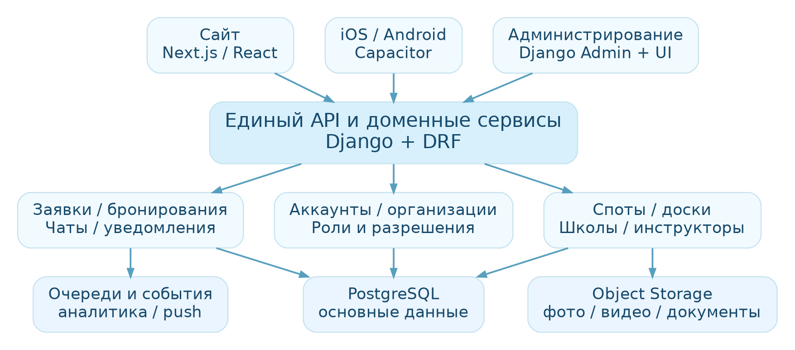
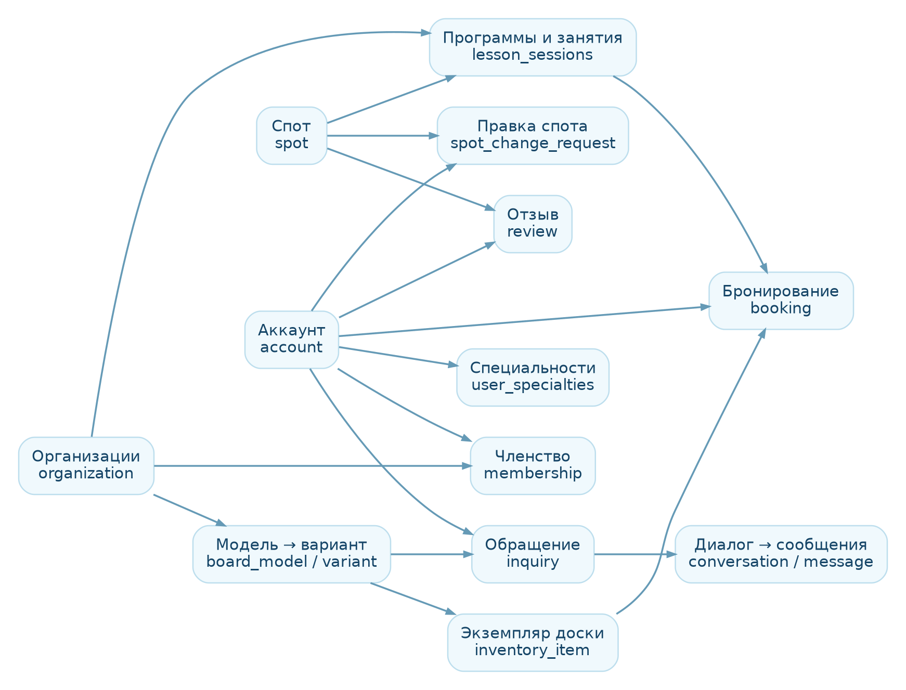

**ГДЕВОЛНА**

**Техническое задание  
и модель данных**

Платформа 2.0 · единый аккаунт, профессиональные модули, споты,
бронирования и коммуникации

| **Версия**            | **Статус**                              | **База исследования**                           |
|-----------------------|-----------------------------------------|-------------------------------------------------|
| 0.2 / 20 октября 2026 | Расширенное ТЗ: проект для согласования | Исходное ТЗ 0.1 + история требований + HTML v14 |

| Документ фиксирует предлагаемые решения, а не утверждённые требования. Разделы с пометкой «Требует решения» нельзя считать согласованными до подтверждения владельцем продукта. |
|---------------------------------------------------------------------------------------------------------------------------------------------------------------------------------|

Подготовлено как основа для декомпозиции задач, проектирования
Django/PostgreSQL и переноса интерфейса в Next.js. Прототип v14 остаётся
визуальным и функциональным референсом, а не производственным кодом.

# Содержание

1\. Цель, границы и терминология

2\. Исходное состояние и разрывы

3\. Базовые продуктовые правила

4\. Архитектура и технологический стек

5\. Аккаунты, специальности и права

6\. Модель данных и ключевые связи

7\. Сквозные сценарии и статусы

8\. Требования к функциональным модулям

9\. API и интеграционные контракты

10\. События и аналитика

11\. Нефункциональные требования

12\. Миграция из HTML и поставка

13\. Этапы и критерии приёмки

14\. Решения, ожидающие согласования

ЧАСТЬ II. Полный каталог требований (разделы 15–36)  
Приложение A. Словарь сущностей

Приложение Б. Технические оговорки к SQL

# 1. Цель, границы и терминология

Цель: перейти от автономного демонстрационного сайта к единой
многопользовательской платформе, сохранив существующую дизайн-систему и
сценарии. Платформа объединяет сёрферов, инструкторов, шейперов,
сёрф-школы и прокат с общей системой спотов, обращений, бронирований и
модерирования.

## 1.1. Входит в целевой MVP

- Единая регистрация, вход и профиль; подключение нескольких
  специальностей одному человеку.

- Организации (школа, мастерская, прокат), приглашения сотрудников и
  права в организации.

- Публичные каталоги спотов, инструкторов, школ, досок и оборудования;
  поиск и фильтры.

- Обращения и чаты с вложениями; уведомления и синхронизация
  прочитанного.

- Занятия, календари и бронирование без конфликтов; аренда конкретных
  экземпляров.

- Модерация предложений по спотам и материалов, отзывы с проверкой
  личности.

- Персональные и профессиональные метрики на основе фактических событий.

## 1.2. За рамками первого релиза

Маркетплейс-платежи и распределение денег между исполнителями; сложный
склад и логистика; развитая программа лояльности; AI-рекомендации;
офлайн-первый режим; публичный API партнёров. Для этих функций
предусматриваются точки расширения, но они не блокируют MVP.

## 1.3. Термины

| **Термин**                   | **Определение**                                                              |
|------------------------------|------------------------------------------------------------------------------|
| Аккаунт                      | Единственная пользовательская идентичность с постоянным UUID.                |
| Специальность                | Подключаемая функциональность: сёрфер, инструктор, шейпер, оператор проката. |
| Организация                  | Школа, мастерская или прокат с собственными ресурсами и участниками.         |
| Членство                     | Связь аккаунта с организацией и полномочиями, подтверждённая приглашением.   |
| Обращение                    | Заявка или вопрос клиента; может иметь диалог до принятия в работу.          |
| Бронирование                 | Резервирование ограниченного ресурса на конкретное время.                    |
| Модель / вариант / экземпляр | Линейка изделия / размерная конфигурация / физическая доска.                 |

# 2. Исходное состояние и разрывы

Проверено по HTML-файлу
«ГДеволна_мобильный_сайт_отзывы_спотов_v14.html». В нём присутствуют
основные публичные разделы, единый визуальный кабинет, подключаемые
направления и прототип кабинета школы. Большая часть данных сохраняется
на стороне браузера и в отдельных состояниях модулей.

| **Область**      | **Сейчас (наблюдение)**                        | **Цель**                                          |
|------------------|------------------------------------------------|---------------------------------------------------|
| Пользователь     | Локальная структура gg_user и другие хранилища | Единый account.id + backend authentication        |
| Шейпер           | Собственное состояние мастерской / каталога    | Связь с account.id и organization.id              |
| Школа            | Демо-записи занятий, команды и учеников        | Сотрудники = аккаунты, записи = бронирования      |
| Чаты             | Локальные демо-сообщения и счётчики            | Один сервис сообщений и read state                |
| Отзывы спотов    | Добавление локального комментария и перерасчёт | Публичные проверяемые отзывы, серверная агрегация |
| Модерация спотов | Локальные предложения изменений                | Серверная очередь решений + audit log             |
| Аналитика        | Часть показателей — демоданные                 | Только считаемые подтверждённые события           |

| Принцип миграции: пользовательский интерфейс v14 используем как референс; нельзя переносить в производственную базу демонстрационные отзывы, обращения и рейтинги как реальные записи. |
|----------------------------------------------------------------------------------------------------------------------------------------------------------------------------------------|

# 3. Базовые продуктовые правила

**BR-01.** Каталоги публично доступны любому посетителю; регистрация
профессионального направления не требуется для просмотра и подачи
заявки.

**BR-02.** Один аккаунт может подключить несколько специальностей;
подключение не создаёт новую пользовательскую идентичность.

**BR-03.** Сёрф-школа — организация; пользователь может владеть
несколькими организациями или работать в них одновременно.

**BR-04.** Администратор и модератор — серверные роли, которые нельзя
включить пользовательским переключателем.

**BR-05.** Владелец не может оформить обращение или отзыв в отношении
самого себя или своей подконтрольной организации, когда это запрещено
бизнес-правилом.

**BR-06.** Чат доступен после создания обращения и до ответа
исполнителя; принятие обращения меняет рабочий статус, но не разрешает
отправку сообщений.

**BR-07.** Сертификат инструктора доброволен; публичный значок
«проверен» показывается только после модерации документа.

**BR-08.** Рейтинг спота меняется только по опубликованным реальным
отзывам; исходные демооценки не учитываются.

**BR-09.** Модель доски отделена от варианта и физического экземпляра;
стабильные идентификаторы не зависят от размеров и названия.

**BR-10.** Факт чтения сообщения, резерва и смены статуса хранится на
сервере и одинаков на устройствах.

**BR-11.** Отключение специальности скрывает инструменты, но не удаляет
автоматически историю, заказы или обязательные документы.

**BR-12.** GG Surfer — отдельное согласие на поиск и социальные
контакты, а не обязательная публичность аккаунта.

# 4. Архитектура и технологический стек

*Рисунок 1. Целевая архитектура. Монолитный backend с доменными
модулями.*

| **Слой**             | **Решение**                              | **Почему**                                                |
|----------------------|------------------------------------------|-----------------------------------------------------------|
| Веб                  | Next.js / React / TypeScript             | Переиспользование компонентов, SEO публичных страниц.     |
| Сервер               | Python / Django / Django REST Framework  | Доменная логика, аутентификация, админ-интерфейс.         |
| БД                   | PostgreSQL                               | Транзакции, строгие связи, аналитические выборки.         |
| Медиа                | S3-совместимое объектное хранилище       | Отдельное хранение фото и видео от бизнес-данных.         |
| Фоновые задачи       | Celery + Redis (при необходимости)       | Уведомления, обработка медиа, события.                    |
| Реалтайм             | WebSocket / события или managed realtime | Доставка новых сообщений, статусы read.                   |
| Мобильные приложения | Capacitor (после разделения web/API)     | Единая UI-логика; отдельная проверка сценариев устройств. |
| Доставка             | Docker + CI/CD + staging                 | Повторяемые сборки и миграции.                            |

## 4.1. Технические ограничения

- Next.js не должен содержать единственную реализацию бизнес-правил: API
  валидирует права и статусы независимо от клиента.

- Для мобильной сборки заранее отделить браузерные страницы от серверной
  логики Next.js: Capacitor требует совместимой клиентской сборки или
  контролируемой загрузки с сервера.

- Начать с модульного монолита Django; микросервисы не нужны, пока нет
  фактической нагрузки и независимых команд.

- Сделать отдельные окружения dev/staging/prod. В продакшен нельзя
  выкладывать демоданные без явной маркировки.

# 5. Аккаунты, специальности и права доступа

## 5.1. Идентичность и специальности

accounts.id — неизменяемый UUID. Публичный handle может меняться с
политикой редиректов; ссылки заказа, отзыва, сообщения и членства
продолжают указывать на ID. Специальности представлены отдельной
таблицей user_specialties. Сёрф-школа подключается не как «тип
аккаунта», а как организация с правом управления.

## 5.2. Матрица прав (проект)

| **Действие**                        | **Гость**     | **Пользователь** | **Исполнитель / сотрудник**  | **Модератор**             |
|-------------------------------------|---------------|------------------|------------------------------|---------------------------|
| Просмотр опубликованных каталогов   | Да            | Да               | Да                           | Да                        |
| Редактирование собственного профиля | Нет           | Да               | Да                           | Да, только свой           |
| Подключение специальности           | Нет           | Да               | Да                           | Да                        |
| Изменение чужой мастерской / школы  | Нет           | Нет              | Только в рамках членства     | По служебному полномочию  |
| Обращение к исполнителю             | После входа\* | Да               | Да, кроме своего предложения | Да как пользователь       |
| Публикация сертификата «проверен»   | Нет           | Нет              | Нет                          | Да по результату проверки |
| Решение по правке спота             | Нет           | Нет              | Нет                          | Да                        |
| Удаление чужих материалов           | Нет           | Нет              | Нет                          | По политике модерации     |

\*Решение о гостевом обращении требует утверждения; рекомендуется
авторизация перед отправкой, чтобы сохранить историю и исключить спам.

## 5.3. Авторизация и членства

- Начальный MVP: email + пароль с проверкой адреса; вход по коду/соцсети
  — отдельным решением.

- Приглашения в школу адресуются аккаунту; назначение роли активируется
  только после принятия приглашения.

- Никакая клиентская кнопка не даёт право owner/admin/moderator; каждое
  действие проверяет сервер.

- У владельца организации должен существовать механизм передачи владения
  и удаления сотрудника без утраты заказов школы.

- Для административных операций обязательны усиленная аутентификация и
  аудит.

# 6. Модель данных и ключевые связи

*Рисунок 2. Укрупнённая доменная модель (не все поля и связи показаны).*

## 6.1. Разделение доменов

**Identity.** accounts, user_profiles, specialties, user_specialties

**Organizations.** organizations, organization_memberships

**Locations.** spots, spot_conditions, spot_change_requests

**Learning.** instructor_offers, school_programs, lesson_sessions

**Boards & Rental.** board_models, board_variants, inventory_items

**Commerce.** inquiries, bookings

**Communications.** conversations, conversation_participants, messages,
message_attachments, notifications

**Trust.** reviews, moderation_cases, audit_events

**Analytics.** analytics_events

**Media.** media_assets, board_media

## 6.2. Инварианты целостности

- В каждом заказе присутствует единственный customer_id, а исполнитель
  однозначно задаётся provider_account_id или provider_organization_id.

- Один inquiry может иметь один основной conversation; сообщения
  разрешены до принятия обращения.

- В одном наборе дат физический rental inventory_item не может иметь две
  подтверждённые пересекающиеся брони.

- Урок имеет capacity; подтверждение записи происходит в транзакции с
  блокировкой строки занятия.

- У instructor_id назначенного на урок инструктора не может быть
  пересекающихся подтверждённых уроков, если правило доступности не
  допускает совмещение.

- Публичный рейтинг не хранится как произвольное число: он агрегируется
  по опубликованным отзывам; можно кешировать вычисленный результат.

- Артикул SKU уникален, ID board_variants.id постоянен; смена
  конструкции после заказов требует нового варианта либо версии.

- Удаление личных данных учитывает законные обязательства хранения
  заказов и журналов; доступ ограничивается, а данные анонимизируются,
  где это допустимо.

# 7. Сквозные сценарии и статусы

## 7.1. Подключение направления

1.  Аккаунт авторизован → пользователь выбирает «Мои направления».

2.  Система проверяет допустимость и создаёт или активирует
    user_specialties; не меняет account.id.

3.  Если нужна организация — предлагается «Создать» или «Присоединиться
    по приглашению».

4.  Публичная карточка опубликована только после обязательных полей и,
    при необходимости, модерации.

5.  Отключение специальности не уничтожает активные брони; система
    предупреждает и предлагает остановить публикацию.

## 7.2. Обращение и чат

| **Текущий статус** | **Событие**                 | **Новый статус / эффект**                    |
|--------------------|-----------------------------|----------------------------------------------|
| new                | Отправлено первое сообщение | new; conversation создан, доступен обоим     |
| new                | Исполнитель принял в работу | in_progress; связанный чат без изменений     |
| new / in_progress  | Исполнитель отказал         | declined; диалог остаётся доступен в истории |
| in_progress        | Работа завершена            | completed; отзыв допускается по политике     |
| new / in_progress  | Клиент отменил              | cancelled; уведомление исполнителю           |

| Непрочитанность не является статусом обращения. Она считается по read-состоянию каждого участника диалога. «2 новых» должно означать 2 фактически непрочитанных сообщения, а не 2 существующих чата. |
|------------------------------------------------------------------------------------------------------------------------------------------------------------------------------------------------------|

## 7.3. Бронирование

| **Статус**                        | **Кто меняет**           | **Проверки**                                    |
|-----------------------------------|--------------------------|-------------------------------------------------|
| requested → confirmed             | Исполнитель / менеджер   | Свободная вместимость/ресурс; время; полномочия |
| requested → declined              | Исполнитель              | Причина отказа, уведомление                     |
| confirmed → in_progress           | Исполнитель / расписание | Факт начала (опционально)                       |
| in_progress → completed           | Исполнитель              | Завершение и доступность отзыва                 |
| requested / confirmed → cancelled | Уполномоченная сторона   | Политика отмены, освобождение ресурса           |
| confirmed → no_show               | Исполнитель              | Фиксация неявки с протоколом споров             |

## 7.4. Изменения спота

submitted → needs_info / approved / rejected / withdrawn. При approved
обновление данных спота и запись audit_events выполняются одной
транзакцией. Автор видит результат и комментарий модератора; публичная
карточка не меняется до принятия.

## 7.5. Отзыв

Пользователь пишет отзыв, он проходит проверки на саморецензирование,
допустимость цели и модерацию. При публикации рейтинг пересчитывается по
реальным published-отзывам (средняя арифметическая, число отзывов).
Пользователь может редактировать свой отзыв в рамках политики; повторное
создание не увеличивает число голосов.

# 8. Требования к функциональным модулям

## 8.1. Споты

- Публичная карточка: геоположение с уровнем точности, описание,
  сложность, тип дна, опасности, рекомендованные направления ветра и
  свелла.

- Отдельные поля «типичные условия» и «текущий прогноз» с источником и
  временем измерения; прогноз — после подключения провайдера.

- Форма предложения изменения с типизированными полями и сравнением
  «было → предлагается».

- Отзывы по споту с профилем автора; подтверждённые опубликованные
  отзывы пересчитывают рейтинг.

- Модерация и журнал источников, возможность скрыть точные координаты
  чувствительных мест.

## 8.2. Инструкторы

- Профиль инструктора: специализации, уровни учеников, споты, ставки,
  фотографии, календарь.

- Сертификат необязателен: «не указан» / «загружен» / «проверен»; сканы
  не доступны публично без основания.

- Личное расписание учитывает также занятия школы, где инструктор
  состоит в команде.

- Переносы, отмены, учёт факта занятия и повторных учеников.

## 8.3. Сёрф-школы

- Организация с членствами и приглашениями, а не отдельный логин.

- Программы: уровень, продолжительность, стоимость, описание,
  вместимость.

- Сессии: дата, время, спот, инструктор, количество мест, статус; брони
  занимают места.

- Кабинеты владельца, менеджера и инструктора имеют разные права;
  занятие видно в одном источнике данных.

- Отчёты по посещаемости, повторным ученикам, загрузке групп и конверсии
  в запись.

## 8.4. Шейперы и доски

- Публичный каталог доступен всем; шейпер управляет только своей
  мастерской.

- Модель → варианты с размерами и материалами → экземпляры для продажи
  или аренды.

- Фото до 10 на вариант, видео отдельным медиаобъектом; управление
  порядком и удалением.

- Human-readable SKU строится из стабильного идентификатора
  изготовителя/варианта и атрибутов, при этом внутренние UUID неизменны.

- Отдельные обращения на покупку, индивидуальное изготовление, ремонт;
  чат доступен до принятия.

- При продаже/аренде конкретного экземпляра обновляются наличие и
  календарь доступности.

## 8.5. Аренда

- В каждой позиции указаны владелец, тип, время доступности, тариф и
  ограничения.

- Транзакционное резервирование экземпляра без наложения подтверждённых
  периодов.

- Акты выдачи/возврата, повреждения, залоги и расчёты — в отдельном
  этапе после утверждения коммерческой политики.

## 8.6. Обращения, уведомления, избранное

- Единый inbox с фильтрами «Клиент / Шейпер / Школа / Инструктор /
  Прокат», а не пять независимых входящих.

- Системные уведомления: новое сообщение, заявка, изменение статуса,
  подтверждение брони, решение модератора.

- Счётчики — агрегаты непрочитанных событий; индивидуальный read_at для
  уведомления и read cursor диалога.

- Фото в переписке загружается в media_assets и прикрепляется через
  message_attachments; проверяются тип, размер, безопасность файла.

- Избранное должно ссылаться на реальные типизированные объекты: спот,
  школу, инструктора, модель, экземпляр.

# 9. API и интеграционные контракты

Единый API должен быть версионирован (/api/v1/), документирован OpenAPI
и обеспечивать строгую проверку авторизации по запросу. Ответы на ошибки
— единый формат с кодом, сообщением и списком полей.

| **Метод / путь (эскиз)**                | **Действие**                | **Доступ**             |
|-----------------------------------------|-----------------------------|------------------------|
| POST /auth/register                     | Создать аккаунт             | Гость                  |
| GET/PATCH /me                           | Получить/изменить профиль   | Владелец               |
| PUT /me/specialties/{code}              | Подключить направление      | Владелец               |
| POST /organizations                     | Создать организацию         | Авторизован            |
| POST /organizations/{id}/invites        | Пригласить сотрудника       | Owner / admin          |
| GET /spots                              | Публичный поиск спотов      | Все                    |
| POST /spots/{id}/proposals              | Предложить правку           | Авторизован            |
| POST /moderation/proposals/{id}/approve | Согласовать правку          | Модератор              |
| GET /shapers/{id}/boards                | Каталог моделей шейпера     | Все                    |
| POST /inquiries                         | Открыть обращение           | Авторизован, не к себе |
| POST /conversations/{id}/messages       | Сообщение/вложение          | Участник               |
| POST /bookings                          | Создать бронь               | Авторизован            |
| POST /bookings/{id}/confirm             | Подтвердить бронь           | Поставщик / член орг.  |
| POST /reviews                           | Создать/заменить свой отзыв | Авторизован            |
| GET /me/notifications                   | Лента уведомлений           | Владелец               |

## 9.1. Интеграционные принципы

- Idempotency-Key на критические POST создания заказов и платежей:
  повторы не создают дубли.

- Пагинация/сортировка, лимиты выдачи и версионирование контрактов;
  единый формат дат ISO 8601 с timezone.

- Файлы загружаются через ограниченную временную ссылку; API хранит
  ключ, но не сам бинарный файл.

- Webhook и события оформлять идемпотентно, с retry и журналом
  неуспешной доставки.

- Клиентские вычисления не являются источником правды для цен, рейтингов
  и доступности.

# 10. События и аналитика

Событийная модель необходима до подключения аналитических дашбордов.
События записываются один раз с event_id, субъектом, объектом, timestamp
и контекстом. Бизнес-факты берутся из завершённых транзакций, а не из
кликов.

| **Событие**            | **Для какой метрики**          | **Предосторожность**                                 |
|------------------------|--------------------------------|------------------------------------------------------|
| profile_viewed         | Просмотры профиля              | Исключить самопросмотры, ботов и повторы по правилам |
| board_viewed           | Просмотры модели/варианта      | Разделять модель и вариант                           |
| inquiry_created        | Конверсия просмотр → обращение | Единый ID и канал источника                          |
| booking_confirmed      | Подтверждённые записи          | Только факт изменения статуса на сервере             |
| session_completed      | Проведено занятий              | Не по плану, а по подтверждённому факту              |
| booking_cancelled      | Доля отмен                     | Причина и сторона отмены                             |
| review_published       | Средний рейтинг и отзывы       | Только модерированные реальные записи                |
| spot_proposal_reviewed | Скорость модерации             | Время ответа от submitted                            |

## 10.1. Формулы для дашбордов

- Конверсия = число уникальных обращений с указанного каталога / число
  квалифицированных просмотров этого каталога × 100%.

- Заполняемость групп = подтверждённые места / доступные места в
  выбранном периоде × 100%.

- Повторные ученики = число учеников с ≥2 завершёнными занятиями /
  уникальные ученики с ≥1 завершённым занятием × 100%.

- Средняя оценка = сумма оценок опубликованных отзывов / число
  опубликованных отзывов; без отдельного «подмешивания» деморейтингов.

- Показатели требуют версионированных правил дедупликации и часовых
  поясов.

# 11. Нефункциональные требования

| **Категория**  | **Целевой ориентир MVP / политика**                                                                                          |
|----------------|------------------------------------------------------------------------------------------------------------------------------|
| Скорость       | p95 API чтения карточки \< 600 мс при согласованной тестовой нагрузке; первоначально целевое требование, не измеренный факт. |
| Доступность    | Цель 99,5% в месяц после запуска с мониторингом; не гарантия до выбора инфраструктуры.                                       |
| Адаптивность   | Ширины 320–1440 px; нет внешней горизонтальной прокрутки, кроме специально прокручиваемых таблиц.                            |
| Доступность UI | Клавиатура, контраст, лейблы полей, фокус, управление модальными окнами; ориентир WCAG 2.2 AA.                               |
| Безопасность   | HTTPS, защита от CSRF/XSS, ограничение частоты, журнал аудита, контроль IDOR, 2FA для админов.                               |
| Данные         | Регулярные бэкапы + тренировочное восстановление; шифрование чувствительных документов.                                      |
| Приватность    | Сбор минимально необходимых данных, сроки хранения, удаление/экспорт, политика для несовершеннолетних.                       |
| Медиа          | Лимиты размеров, проверка MIME, генерация миниатюр и постеров, контроль доступа.                                             |
| Наблюдаемость  | Логи ошибок, трассировка запросов, метрики очередей и SLA доставки событий.                                                  |

Нагрузочные количественные параметры, требования к доступности и сроки
хранения документов уточняются после определения географии, тарификации
и ожидаемого числа пользователей.

# 12. Миграция из HTML и поставка

## 12.1. План безопасного перехода

6.  Заморозить эталон UI v14 и составить карту экрана → компонент → API
    → таблицы.

7.  Создать репозиторий и монорепо с apps/web, backend, shared UI и
    автоматическими сборками.

8.  Реализовать accounts и org memberships, подключить общее
    login/session и публичные каталоги.

9.  Перенести шейперский модуль по цепочке: публичный каталог → профиль
    мастерской → модель/вариант → обращение → чат.

10. Перенести споты + модерацию; после — расписания школы и независимых
    инструкторов с транзакционными бронированиями.

11. Включить staging с тестовыми аккаунтами и нагрузочными сценариями;
    переключить пользователей на backend, когда тесты пройдены.

## 12.2. Миграция демонстрационных данных

- Демо-аватары, картинки, споты и шаблонные карточки проходят ручную
  классификацию «посевные данные / данные пользователя / не переносить».

- Не переносить синтетические отзывы, обращения, статистику, сообщения и
  сертификаты в реальные записи без подтверждения.

- Существующим локальным пользователям не обещать автоматический перенос
  до разработки согласованного механизма экспорта с устройства и
  сопоставления аккаунта.

- Переходный режим: read-only legacy (при необходимости), idempotent
  importer, протокол миграции и откат.

# 13. Этапы и критерии приёмки

| **Этап**        | **Результат**                             | **Критерий готовности**                                        |
|-----------------|-------------------------------------------|----------------------------------------------------------------|
| 0 — Архитектура | Утверждённые сущности, роли, статусы, API | Открытые решения разобраны, риски оформлены                    |
| 1 — Identity    | Аккаунты, специальности, организации      | 1 пользователь с 3 направлениями; доступ только к своим данным |
| 2 — Каталоги    | Споты, доски, инструкторы, школы          | Любой клиент видит карточки без проф. регистрации              |
| 3 — Обращения   | Заявки, чат, unread, вложения             | Два аккаунта и два устройства видят одну переписку             |
| 4 — Booking     | Занятия, группы и аренда                  | Два клиента не могут подтвердить один ресурс на одно время     |
| 5 — Trust       | Отзывы, сертификаты, модерация            | Рейтинг и правки зависят от решений сервера                    |
| 6 — Release     | Мониторинг, бэкапы, адаптивность          | Тестирование и восстановление пройдены                         |

## 13.1. Минимальные приёмочные сценарии

- AT-01. Сёрфер просматривает каталог шейперов, открывает модель и
  отправляет заявку без подключения шейпера.

- AT-02. Пользователь добавляет направления instructor и shaper:
  сохраняется один account_id и разные профессиональные инструменты.

- AT-03. Шейпер нажимает «Написать» на собственной доске: сервер
  запрещает обращение к себе.

- AT-04. Клиент отправляет два сообщения до принятия заявки; исполнитель
  получает два непрочитанных, открывает чат — счётчик становится
  нулевым.

- AT-05. Два клиента подтверждают аренду одного экземпляра на
  пересекающееся время — проходит только одно подтверждение.

- AT-06. Школа назначает инструктора на занятие; запись появляется в его
  расписании, а второй конфликтующий урок блокируется.

- AT-07. Пользователь предлагает изменить направление ветра спота:
  публичная карточка прежняя до approve; после approve обновление и
  audit связаны.

- AT-08. Пользователь оставляет отзыв 4 звезды; он виден после
  модерации; общий рейтинг рассчитывается только по approved/published.

- AT-09. Деактивация членства менеджера немедленно закрывает доступ к
  управлению школой, но не удаляет занятия и историю.

- AT-10. Пользователь запрашивает удаление аккаунта — процедура
  учитывает сохранность необходимых записей и ограничение доступности
  личных данных.

# 14. Решения, ожидающие согласования

| **Вопрос**                | **Предварительная рекомендация**                                    | **Кто утверждает**  |
|---------------------------|---------------------------------------------------------------------|---------------------|
| Монетизация               | MVP без удержания оплаты; платежи отдельным этапом                  | Владелец продукта   |
| Гостевые обращения        | Разрешить просмотр всем, обращение после входа                      | Владелец продукта   |
| Отзыв спота               | Один текущий отзыв на пользователя/спот с возможностью обновления   | Продукт + модерация |
| Проверка школ             | Подтверждение владельца и связи с организацией перед публикацией    | Продукт + юрист     |
| Проверка документов       | Сертификат добровольный; подтверждённый бейдж только после проверки | Продукт + юрист     |
| Инструктор вне школы      | Разрешить самостоятельные предложения и личное расписание           | Владелец продукта   |
| Масштаб географии         | Регионы РФ сначала или международный запуск                         | Владелец продукта   |
| Хранение и юрисдикция     | Определить по территории и категориям персональных данных           | Юрист + техлид      |
| Список платёжных способов | После определения роли платформы в сделках                          | Продукт + финансы   |
| Публикация спотов         | Чувствительные геоточки скрывать/округлять                          | Модерация           |

# ЧАСТЬ II. Полный каталог требований и отложенных блоков

Редакция 0.2. Дополняет техническую часть 0.1 (главы 1–14), не отменяет
её. Создана для передачи продуктовой, инженерной и дизайн-командам.
Каждый пункт снабжён кодом и очередью, а отложенные направления явно
возвращены в целевой объём платформы.

| Статус «Требование» — непосредственно обсуждалось/запрашивалось владельцем продукта. «Проект» — предложенная инженерная/UX-реализация, требует утверждения. «Отложено» — не исключено из продукта, переносится на более позднюю очередь. M0: фундамент, M1: стартовая рабочая версия, M2: расширение, M3: перспективное развитие. |
|-----------------------------------------------------------------------------------------------------------------------------------------------------------------------------------------------------------------------------------------------------------------------------------------------------------------------------------|

## Навигация по дополнению

15\. Цели, границы и полный перечень продукта

16\. Карта сайта и роли

17\. Общий аккаунт и подключаемые специальности

18\. Споты, карты и морские данные

19\. Инструкторы и занятия

20\. Сёрф-школы

21\. Шейперы, модели, доски и ремонт

22\. Аренда и бронирования

23\. GG Surfer, сообщество и активность

24\. Клуб, мероприятия, мерч и отложенные направления

25\. Обращения, чаты, оповещения, избранное

26\. Рейтинги, доверие и модерация

27\. Платежи и коммерческие процессы

28\. Статистика и измерения

29\. UX/UI, адаптивность и дизайн-система

30\. Архитектура API, данные и интеграции

31\. Сквозные пользовательские пути

32\. Макеты и передача дизайна

33\. Декомпозиция очередей и зависимости

34\. Приёмочные сценарии и тестирование

35\. Открытые решения и риски

36\. Матрица полноты / deferred roadmap

# 15. Цели, границы и полный перечень продукта

Продуктовая миссия: объединить выбор места для катания, поиск партнёров
и наставников, обучение, изготовление/покупку/аренду досок, работу школ,
коммуникации и серф-сообщество в одном сервисе «ГДеволна». Важна
последовательность: публичный контент доступен всем, а профессиональные
функции открываются пользователю по специальности.

| **Контур**     | **Содержание**                                       | **Текущий статус**      | **Очередь** |
|----------------|------------------------------------------------------|-------------------------|-------------|
| Публичный сайт | Главная, поиск, разделы, карточки, каталоги          | HTML-демо               | M1          |
| Споты и карта  | Карта, страницы, прогнозы, отзывы, фото, правки      | Частичный HTML-демо     | M1/M2       |
| Инструкторы    | Профиль, фильтры, сертификаты, календарь, заявки     | Демо + формы            | M1          |
| Сёрф-школы     | Организация, программы, группа, команда, управление  | Прототип кабинета       | M1/M2       |
| Шейперы        | Профиль, доски, медиа, ремонт, заявки, статистика    | Подробный HTML-прототип | M1          |
| Аренда         | Доски, гидрокостюмы, бронирования, статусы           | Демо-каталог            | M1/M2       |
| GG Surfer      | Публичное сообщество, знакомства, дневник, избранное | Демо/концепт            | M2          |
| Клуб и события | Клуб, активности, календарь сообщества               | Заготовка/отложено      | M2          |
| Мерч/магазин   | Фирменные товары, термосы, оплата/доставка           | Отложено                | M3          |
| AI-помощник    | Поиск/подбор и консультации по серфингу              | Демо/отложено           | M3          |
| Модератор      | Очереди проверки, права, управление пользователями   | Концепт                 | M1          |
| iOS/Android    | Приложения с общим сервером и push                   | Отложено                | M2/M3       |

| **ID** | **Требование / ожидаемое поведение**                                                                                                                 | **Очередь · источник** |
|--------|------------------------------------------------------------------------------------------------------------------------------------------------------|------------------------|
| PL-01  | Сохранить утверждённую визуальную концепцию: морская голубая палитра, логотип ГДеволна, мягкие карточки, воздушные отступы; развивать без редизайна. | M0 · Требование        |
| PL-02  | Не переносить демонстрационные отзывы, статистику, переписки и сертификаты в производственные данные как реальные.                                   | M0 · Проект            |
| PL-03  | Отдельно учесть все отложенные модули в roadmap и предусмотреть расширяемые доменные связи сейчас.                                                   | M0 · Требование        |
| PL-04  | Единый источник данных для web/PWA/iOS/Android и кабинета администратора.                                                                            | M0 · Проект            |

# 16. Карта сайта и видимость разделов

| **Страница/раздел**               | **Гость**                       | **Авторизован**          | **Владелец/сотрудник**            |
|-----------------------------------|---------------------------------|--------------------------|-----------------------------------|
| Главная, глобальный поиск         | Просмотр                        | Просмотр                 | Просмотр                          |
| Карта/споты                       | Просмотр, без правки            | Отзыв/предложение правки | Те же права                       |
| Инструкторы, школы                | Просмотр карточек               | Бронирование/сообщение   | Редактор собственного предложения |
| Шейперы / все доски / по шейперам | Просмотр досок                  | Запрос/покупка/сообщение | Редактор собственных моделей      |
| Аренда                            | Просмотр объявлений             | Запрос/бронирование      | Управление инвентарём             |
| GG Surfer                         | Согласно настройкам приватности | Контакты/общение         | Управление собственным профилем   |
| Клуб                              | Публичная витрина               | Участие/события          | Управление при полномочиях        |
| Аккаунт                           | Вход/регистрация                | Общие инструменты        | Спец. модули по роли              |
| Модерация                         | Нет                             | Нет                      | Только назначенная роль           |

| **ID** | **Требование / ожидаемое поведение**                                                                                                            | **Очередь · источник** |
|--------|-------------------------------------------------------------------------------------------------------------------------------------------------|------------------------|
| NAV-01 | Переключение между всеми разделами в одном сайте: главная, инструкторы, споты, GG Surfer, аренда, шейперы, клуб и последующие разделы.          | M1 · Требование        |
| NAV-02 | Каталоги должны открываться без включения профессиональной роли; посетителю не предлагать «зарегистрироваться шейпером» вместо просмотра досок. | M1 · Требование        |
| NAV-03 | Мобильная нижняя панель: Главная, Каталог, Избранное, Сообщения, Кабинет; остальные категории через каталог или меню.                           | M1 · Требование        |
| NAV-04 | Унифицированная глобальная поисковая строка с типами результатов: споты, инструкторы, школы, доски, оборудование, пользователи.                 | M1 · Проект            |
| NAV-05 | Глубокие ссылки с уникальными URL на карточки объектов; SEO для публичных страниц, канонические URL и человекочитаемые адреса.                  | M1 · Проект            |

# 17. Общий аккаунт, регистрация и направления

| **ID** | **Требование / ожидаемое поведение**                                                                                                                             | **Очередь · источник** |
|--------|------------------------------------------------------------------------------------------------------------------------------------------------------------------|------------------------|
| ACC-01 | Один человек — один аккаунт; при регистрации основной тип сёрфер/инструктор/шейпер/школа, дополнительные специальности выбираются чекбоксами и доступны позднее. | M1 · Требование        |
| ACC-02 | Обязательные общие экраны: Обзор, Профиль, Обращения, Мои бронирования, Избранное, Уведомления, Настройки, Мои направления.                                      | M1 · Требование        |
| ACC-03 | При подключении шейпера появляются управление досками, линейками, ремонтом, статистикой и профессиональной карточкой; старые данные не теряются.                 | M1 · Требование        |
| ACC-04 | При подключении инструктора: расписание, ученики, занятия, отзывы, показатели по просмотрам и записям.                                                           | M1 · Требование        |
| ACC-05 | При подключении проката: инвентарь, доступность, выдача/возврат, бронирования.                                                                                   | M1 · Требование        |
| ACC-06 | GG Surfer — независимое согласие на отображение в поиске сообщества; его можно отключить без потери аккаунта.                                                    | M1 · Требование        |
| ACC-07 | Личное фото редактируется только в Профиле; тап на аватар в шапке ведёт в кабинет, не открывает загрузку.                                                        | M1 · Требование        |
| ACC-08 | В Профиле единая регистрационно-редакционная форма с текстом кнопки по состоянию; «Посмотреть на сайте» открывает публичное представление.                       | M1 · Требование        |
| ACC-09 | Вкладки Профиль и Настройки расположить рядом; не дублировать один редактор данных в разных местах.                                                              | M1 · Требование        |
| ACC-10 | Роли администратора/модератора нельзя подключать через пользовательские переключатели.                                                                           | M0 · Требование        |
| ACC-11 | Сёрф-школа как организация создаётся отдельно; владелец может пригласить существующие аккаунты инструкторов, назначить сотрудникам роли.                         | M1 · Требование        |
| ACC-12 | Возможность смены роли и отключения направления без уничтожения истории заказов, клиентов и финансовых записей.                                                  | M0 · Проект            |
| ACC-13 | Вход, восстановление доступа, верификация email/телефона; удаление, экспорт данных и согласия.                                                                   | M0 · Проект            |
| ACC-14 | Публичные поля профиля отдельно от закрытых данных (адрес, контакты, документы, история переписки).                                                              | M0 · Проект            |
| ACC-15 | Перед публикацией профессионального профиля проверять минимально необходимые поля и корректность прав владения.                                                  | M1 · Проект            |

# 18. Серф-споты, карта и морские данные

## 18.1. Карта и отдельная страница спота

| **ID** | **Требование / ожидаемое поведение**                                                                                                                        | **Очередь · источник** |
|--------|-------------------------------------------------------------------------------------------------------------------------------------------------------------|------------------------|
| SPT-01 | Интерактивная карта с точками и группировкой спотов, региональными фильтрами, карточкой по нажатию; отдельная детальная страница каждого спота.             | M1 · Требование        |
| SPT-02 | Карточка спота: название, регион, координаты, характер волн/брейка, дно, уровень сложности, сезон, направление волн и ветра, подъезд и инфраструктура.      | M1 · Требование        |
| SPT-03 | Фотографии, галерея, избранное, рейтинг со звёздами и отзывами; автор, дата, комментарий, аватар автора.                                                    | M1 · Требование        |
| SPT-04 | Карточка: типично благоприятный ветер и свелл в виде наглядных компасных диаграмм; не смешивать их с прогнозом.                                             | M1 · Требование        |
| SPT-05 | Показывать течения, рифы, опасные участки, особенности входа/выхода, мощность волн, сезоны, уровень подготовки.                                             | M1 · Требование        |
| SPT-06 | Инфраструктура спота: парковка, туалет, душ, кафе, школы, прокат, с расстояниями и картой/маршрутом по мере наличия данных.                                 | M2 · Требование        |
| SPT-07 | Направления ветра/волны пользователь вправе предложить через форму по значку карандаша на фото, но опубликованная карточка меняется только после модерации. | M1 · Требование        |
| SPT-08 | Форма правки: выбрать атрибуты, предложить новые значения, направления ветра, описание, источник, фото-доказательства, комментарий; статус предложения.     | M1 · Требование        |
| SPT-09 | Убрать кнопку «Открыть спутник» из карточки; спутниковые/3D-возможности, если реализуются, размещать в интерфейсе карты отдельно.                           | M1 · Требование        |
| SPT-10 | Рейтинг пересчитывать по опубликованным звёздным отзывам; комментарий появляется снизу, данные отделены по спотам.                                          | M1 · Требование        |
| SPT-11 | Отдельно фиксировать дату последнего подтверждения сведений и происхождение данных.                                                                         | M1 · Проект            |
| SPT-12 | Приватность чувствительных спотов: возможность скрыть точную геометку/показывать район.                                                                     | M1 · Проект            |

## 18.2. Отложенные расширения картографии

| **ID** | **Требование / ожидаемое поведение**                                                                                                                | **Очередь · источник** |
|--------|-----------------------------------------------------------------------------------------------------------------------------------------------------|------------------------|
| GEO-01 | Трёхмерный просмотр рельефа и окрестностей, вращение/масштабирование; провайдера Google Maps/3D и лицензирование проверить отдельно.                | M3 · Отложено          |
| GEO-02 | Батиметрия: данные о рельефе дна; изменение песчаных банок допустимо показывать только при наличии фактических обновлений и источника.              | M3 · Отложено          |
| GEO-03 | Веб-камеры спотов, в т.ч. возможный premium-доступ: права на видеопоток, доступность, тарифы и отказоустойчивость.                                  | M3 · Отложено          |
| GEO-04 | Прогноз волн/ветра/прилива, временные ряды, окна катания и источник/время актуальности прогноза; при недостатке данных показывать неопределённость. | M2 · Отложено          |
| GEO-05 | Тематические региональные визуальные элементы (вулканы, природные мотивы), умеренно, не заслоняя карту и текст.                                     | M2 · Требование        |
| GEO-06 | Возможность отображать динамические ограничения доступа к споту, сезонные предупреждения и статус закрытия.                                         | M2 · Проект            |

# 19. Сёрф-инструкторы и обучение

| **ID** | **Требование / ожидаемое поведение**                                                                                                                      | **Очередь · источник** |
|--------|-----------------------------------------------------------------------------------------------------------------------------------------------------------|------------------------|
| INS-01 | Карточка инструктора: имя, фамилия, фото, регион, споты занятий, стаж сёрфинга/преподавания, уровень катания, форматы и уровни учеников, типы досок.      | M1 · Требование        |
| INS-02 | Раздел «О себе» + пара забавных фактов; цены, сроки, языки занятий и контактные сценарии при наличии.                                                     | M1 · Требование        |
| INS-03 | В карточке видимый знак сертификата с градацией «не указан / загружен / проверен»; сертификат желателен, но необязателен для регистрации.                 | M1 · Требование        |
| INS-04 | Фото/скан сертификата можно показать при разрешённом доступе, личные данные на документе скрывать; проверка — модератором.                                | M1 · Требование        |
| INS-05 | Документы о месте работы не обязательны для независимого инструктора; запрашивать подтверждение связи со школой при необходимости назначения/верификации. | M1 · Требование        |
| INS-06 | Кабинет инструктора: расписание, слоты, отмены, переносы, ученики, проведённые занятия, отзывы, статистика.                                               | M1 · Требование        |
| INS-07 | Личное расписание учитывает занятия в школах и частные уроки, не допускает двойного бронирования одного инструктора.                                      | M1 · Проект            |
| INS-08 | Объекты предложения: индивидуальные и групповые занятия, уровень учеников, продолжительность, стоимость, спот, экипировка и правила.                      | M1 · Проект            |
| INS-09 | Клиенту доступны фильтры по региону, споту, уровню, типу доски, стоимости, сертификату, дате, отзывам.                                                    | M1 · Требование        |
| INS-10 | Просмотры профиля, обращения, конверсия, уникальные/повторные ученики, проведённые уроки, средняя оценка.                                                 | M1 · Требование        |
| INS-11 | Сертификат и его верификация не должны ошибочно трактоваться как гарантия безопасности; формулировку согласовать с юридическим блоком.                    | M1 · Проект            |
| INS-12 | Управление фото и видео: добавление, предпросмотр, удаление крестиком, мобильная сетка миниатюр.                                                          | M1 · Требование        |

# 20. Сёрф-школы: организация, расписания и персонал

| **ID** | **Требование / ожидаемое поведение**                                                                                                     | **Очередь · источник** |
|--------|------------------------------------------------------------------------------------------------------------------------------------------|------------------------|
| SCH-01 | Сёрф-школа — организация, отдельная от личного аккаунта; один владелец может приглашать менеджеров и инструкторов.                       | M1 · Требование        |
| SCH-02 | Публичная карточка школы: название, бренд/фото, описание, регион, споты, форматы обучения, программы, команда, стоимость, рейтинг.       | M1 · Проект            |
| SCH-03 | Кабинет школы: Обзор, Профиль школы, Программы, Расписание, Ученики, Команда, Оборудование, Обращения, Аналитика, Отзывы.                | M1 · Требование        |
| SCH-04 | Программы: уровни, возрастные категории, индивидуально/группа, длительность, стоимость, максимальный размер группы.                      | M1 · Требование        |
| SCH-05 | Сессии: дата/время/спот, инструктор, вместимость, свободные места, статусы, переносы в связи с погодой.                                  | M1 · Требование        |
| SCH-06 | Менеджер распределяет заявки по занятиям/инструкторам; инструктор видит назначенные уроки в собственном календаре.                       | M1 · Требование        |
| SCH-07 | Инструктор может работать в нескольких школах и самостоятельно; избежать конфликтов доступности.                                         | M1 · Проект            |
| SCH-08 | Курс на несколько занятий, пакетные записи, лист ожидания, повторные бронирования и перенос.                                             | M2 · Проект            |
| SCH-09 | Команда: приглашение по email/аккаунту, принятие приглашения, роли owner/manager/instructor, отзыв доступа, журнал действий.             | M1 · Проект            |
| SCH-10 | Ученики и посещаемость: история уроков, прогресс, уровень, комментарии преподавателя с проверкой доступа.                                | M1 · Проект            |
| SCH-11 | Если ученик несовершеннолетний, бронирование и согласия оформляет уполномоченный взрослый.                                               | M1 · Проект            |
| SCH-12 | Статистика школы: просмотры/конверсия, записи, уникальные и повторные ученики, посещаемость, заполняемость групп, качество инструкторов. | M1 · Требование        |
| SCH-13 | Публикация школы — после заполнения данных и проверки связи с организацией по согласованной политике.                                    | M1 · Проект            |

# 21. Шейперы, доски, линейки, ремонт

## 21.1. Профиль шейпера и публичный каталог

| **ID** | **Требование / ожидаемое поведение**                                                                                                                              | **Очередь · источник** |
|--------|-------------------------------------------------------------------------------------------------------------------------------------------------------------------|------------------------|
| SHP-01 | Кнопка «Зарегистрироваться как шейпер» — только в первичной форме; «Сохранить изменения» — при редактировании.                                                    | M1 · Требование        |
| SHP-02 | Фото профиля компактное, круглое, расположено слева от названия; редактирование фото — только в профиле.                                                          | M1 · Требование        |
| SHP-03 | Промо-видео шейпера — отдельный слот (один ролик) и просмотр в публичной карточке мастера.                                                                        | M1 · Требование        |
| SHP-04 | Поле «Делаю ремонт» с переключателем; признак виден в каталоге и доступен в фильтрах.                                                                             | M1 · Требование        |
| SHP-05 | Материалы мастер может добавлять самостоятельно; пользовательские типы досок из профиля автоматически появляются в селекторе каждой его модели.                   | M1 · Требование        |
| SHP-06 | Типы досок включают Fish/Фиш, Gun/Ган и другие стандартные виды; силуэты в UI соответствуют реальным формам.                                                      | M1 · Требование        |
| SHP-07 | Каталог открывается всем, не только шейперам: «Все доски» и «По шейперам».                                                                                        | M1 · Требование        |
| SHP-08 | Карточка шейпера: компактное знакомство, специализация, услуги, сроки, регион, отзыв/рейтинг, несколько моделей и кнопка профиля.                                 | M1 · Требование        |
| SHP-09 | Модели пролистываются внутри карточки шейпера без открытия подробного профиля; кнопку «Перейти в профиль» закрепить слева снизу.                                  | M1 · Требование        |
| SHP-10 | Подробный профиль открывается во всплывающем окне, не на отдельной странице в прототипе; в production обеспечить URL/deep-link при сохранении UX модального окна. | M1 · Требование        |
| SHP-11 | Клиент не может написать самому себе/своей мастерской или заказать собственную модель.                                                                            | M0 · Требование        |
| SHP-12 | Публичный профиль содержит кнопку «Посмотреть на сайте» в кабинете мастера.                                                                                       | M1 · Требование        |

## 21.2. Управление модельным рядом

| **ID** | **Требование / ожидаемое поведение**                                                                                                  | **Очередь · источник** |
|--------|---------------------------------------------------------------------------------------------------------------------------------------|------------------------|
| BRD-01 | Раздел «Мои доски» — единственное место управления моделями; панель управления показывает только сводку без дублирующего редактора.   | M1 · Требование        |
| BRD-02 | Карточка доски: название, тип, длина, ширина, толщина (при необходимости), объём, материал, вид закладных, цена, статус, описание.    | M1 · Требование        |
| BRD-03 | Не более 10 фото в галерее модели, одно отдельное видео ниже; возможности предпросмотра, выбора обложки, порядка, удаления крестиком. | M1 · Требование        |
| BRD-04 | Мобильные миниатюры фото в сетке под слотом загрузки, без вертикальной узкой полосы; видео отдельной компактной плиткой.              | M1 · Требование        |
| BRD-05 | Артикул сквозной: код шейпера, тип, длина, ширина, суффикс; формат согласовать, сервер гарантирует уникальность.                      | M1 · Требование        |
| BRD-06 | Внутренний неизменяемый UUID отличается от отображаемого артикула, редактирование параметров не ломает заказы.                        | M0 · Проект            |
| BRD-07 | Модель, размерный вариант и физический экземпляр — разные сущности; количество и доступность экземпляров отражаются в каталоге.       | M1 · Проект            |
| BRD-08 | Название модели кликабельно и открывает «Фото и параметры»; кнопку «Фото и параметры» поместить справа сверху карточки.               | M1 · Требование        |
| BRD-09 | В собственной карточке вместо «…» использовать понятный значок редактирования (карандаш).                                             | M1 · Требование        |
| BRD-10 | Простые и гармоничные иконки для размеров и объёма; корректное масштабирование SVG.                                                   | M1 · Требование        |
| BRD-11 | Кнопку «Сохранить модель» назвать «Сохранить»; после успешной записи показать результат.                                              | M1 · Требование        |
| BRD-12 | Сохранить массовое табличное редактирование моделей; на телефоне только внутренняя горизонтальная прокрутка таблицы.                  | M1 · Требование        |
| BRD-13 | Статусы «В наличии / Под заказ / Нет в наличии» связаны с реальным инвентарём, продажей, бронью и сроком.                             | M1 · Проект            |

## 21.3. Заявки, ремонт и аналитика

| **ID** | **Требование / ожидаемое поведение**                                                                                                           | **Очередь · источник** |
|--------|------------------------------------------------------------------------------------------------------------------------------------------------|------------------------|
| SHO-01 | В панель управления вынести вверх обращения и статистику, модели ниже; статистика в компактной одной строке.                                   | M1 · Требование        |
| SHO-02 | Раздел «Обращения» объединяет «Входящие заявки» и «Чаты»; после принятия заявки доступен связанный диалог, но писать можно и до принятия.      | M1 · Требование        |
| SHO-03 | «Мои заявки на доски» — исходящие клиента внутри его аккаунта, со значком отправки; не в публичном каталоге.                                   | M1 · Требование        |
| SHO-04 | Новая заявка отражается у шейпера, непрочитанные сообщения учитываются в кружке уведомлений и исчезают после просмотра.                        | M1 · Требование        |
| SHO-05 | Статусы в работе/завершить/отказать/отменить с единым словарём и визуальными метками.                                                          | M1 · Требование        |
| SHO-06 | Ремонт — отдельное обращение с проблемой, фото повреждения, предварительной ценой, сроком и подтверждёнными этапами.                           | M2 · Проект            |
| SHO-07 | Метрики: модели, активные и завершённые обращения, уникальные клиенты, конверсия, чек, фактическая выручка, продажи, аренда, интерес по типам. | M1 · Требование        |
| SHO-08 | Отзывы о мастере с аватаром пользователя и прозрачной политикой публикации.                                                                    | M1 · Требование        |
| SHO-09 | Формулировку «Развивайте мастерскую с Гдеволна» выводить с новой строки там, где используется промо-текст.                                     | M1 · Требование        |

# 22. Аренда, бронирования, склад и доступность

| **ID**  | **Требование / ожидаемое поведение**                                                                                       | **Очередь · источник** |
|---------|----------------------------------------------------------------------------------------------------------------------------|------------------------|
| RENT-01 | Каталог аренды досок, гидрокостюмов и другого инвентаря с фото, состоянием, размерами, регионом, ценой и местом получения. | M1 · Требование        |
| RENT-02 | Оборудование могут публиковать серферы, инструкторы, школы и прокаты при включении соответствующей функции.                | M1 · Требование        |
| RENT-03 | Для конкретной физической доски вести доступность по интервалам, количество свободных и забронированных экземпляров.       | M1 · Требование        |
| RENT-04 | В блоке бронирований выводить собственную строку «Свободных бордов» и «Забронировано» с количествами.                      | M1 · Требование        |
| RENT-05 | Проверка пересечений броней на уровне сервера/транзакции; отображение реальной доступности, а не локального статуса.       | M0 · Проект            |
| RENT-06 | Процесс: запрос → подтверждение → выдача → возврат/повреждение/просрочка → закрытие; сохранять историю изменений.          | M2 · Проект            |
| RENT-07 | Залог, возврат денег, отмена, повреждение и акты передачи реализовать после утверждения коммерческой/правовой политики.    | M2 · Отложено          |
| RENT-08 | Связать аренду с уроком/курсом: клиент может получить рекомендуемую экипировку для выбранного занятия.                     | M2 · Проект            |

# 23. GG Surfer, сообщество и активности

| **ID** | **Требование / ожидаемое поведение**                                                                                        | **Очередь · источник** |
|--------|-----------------------------------------------------------------------------------------------------------------------------|------------------------|
| COM-01 | GG Surfer включается/выключается в общем аккаунте отдельно от основной специальности.                                       | M1 · Требование        |
| COM-02 | Публичный каталог участников: фото, регион, уровень, предпочитаемые доски/споты, стаж, интересы, о себе, забавные факты.    | M2 · Требование        |
| COM-03 | Поиск подходящей компании для катания по региону, споту, уровню и интересам; возможность контакта с учётом приватности.     | M2 · Требование        |
| COM-04 | Учёт дней катания: пользователь отмечает посещение спота и дату; личная статистика и история активности.                    | M2 · Отложено          |
| COM-05 | Поздравления участников с днём рождения от имени проекта по выбранным настройкам/согласиям пользователя.                    | M2 · Отложено          |
| COM-06 | Дневник катания: записи о споте, условиях, доске, времени и впечатлениях, приватность каждой записи.                        | M2 · Требование        |
| COM-07 | Уведомления о событиях сообщества только по подписке; возможность скрыть точное местоположение и заблокировать собеседника. | M1 · Проект            |
| COM-08 | Факты посещения не должны автоматически раскрывать историю перемещений; отдельно запрашивать согласие на геолокацию.        | M1 · Проект            |
| COM-09 | Достижения/серии посещений и дополнительные клубные игровые механики — после запуска основного дневника.                    | M3 · Проект            |

# 24. Клуб, мероприятия, магазин, мерч, AI — отложенные блоки

## 24.1. Клуб и мероприятия

| **ID** | **Требование / ожидаемое поведение**                                                                                   | **Очередь · источник** |
|--------|------------------------------------------------------------------------------------------------------------------------|------------------------|
| CLB-01 | Сохранить раздел «Клуб» как полноценный будущий модуль: страница проекта, участники, анонсы и мероприятия.             | M2 · Отложено          |
| CLB-02 | Календарь совместных катаний и встреч, регистрация на событие, лимиты мест и напоминания — после утверждения механики. | M2 · Проект            |
| CLB-03 | Управление клубными событиями от администратора/уполномоченных организаторов; связь со спотами и участниками.          | M2 · Проект            |
| CLB-04 | Профиль участника показывает добровольно публичные интересы и активность, без выдачи приватных данных.                 | M2 · Проект            |

## 24.2. Фирменные товары и термосы

| **ID**  | **Требование / ожидаемое поведение**                                                                                                              | **Очередь · источник** |
|---------|---------------------------------------------------------------------------------------------------------------------------------------------------|------------------------|
| SHOP-01 | Фирменные термосы ГДеволна с логотипом; при разработке продукта приоритет — высокая теплоизоляция и качество, измеримые техническими параметрами. | M3 · Отложено          |
| SHOP-02 | Витрина мерча с карточками товара, фото/видео, вариантами, ценой, доступностью, доставкой и условиями возврата.                                   | M3 · Отложено          |
| SHOP-03 | Отдельные требования к брендированию: сохранить логотип и слитное написание названия, не менять остальные фигуры знака без согласования.          | M2 · Требование        |
| SHOP-04 | При выборе термоса провести протокол испытаний удержания температуры и герметичности; размеры, материал, гарантия уточняются.                     | M3 · Проект            |

## 24.3. AI и расширенные сервисы

| **ID** | **Требование / ожидаемое поведение**                                                                                                   | **Очередь · источник** |
|--------|----------------------------------------------------------------------------------------------------------------------------------------|------------------------|
| AIX-01 | AI-помощник ГДеволна: помогать пользователю выбрать спот, инструктора, доску и понять условия катания на основании доступных данных.   | M3 · Отложено          |
| AIX-02 | Ответы с источниками, датой прогноза и явными оговорками об условиях безопасности; AI не должен выдавать непроверенные данные за факт. | M3 · Проект            |
| AIX-03 | План развития: подсказки шейперу, подходящий размер доски, подбор курса/уровня, рекомендации контента — только после валидации правил. | M3 · Проект            |
| AIX-04 | Партнёрские интеграции, бонусы и дополнительные способы монетизации — самостоятельное решение после MVP.                               | M3 · Проект            |

# 25. Обращения, сообщения, уведомления, избранное

| **ID** | **Требование / ожидаемое поведение**                                                                                                      | **Очередь · источник** |
|--------|-------------------------------------------------------------------------------------------------------------------------------------------|------------------------|
| MSG-01 | Входящие заявки и чаты объединить в «Обращения», общие счётчики, фильтры ролей/организаций и статусов.                                    | M1 · Требование        |
| MSG-02 | Исходящие заявки сохранять в собственном кабинете клиента, не смешивать с чужими заказами.                                                | M1 · Требование        |
| MSG-03 | Сразу после первого обращения пользователь может продолжать писать исполнителю, даже если тот ещё не ответил или не принял заявку.        | M1 · Требование        |
| MSG-04 | Скрепка в чате для прикрепления фото с телефона, предпросмотр и удаление до отправки.                                                     | M1 · Требование        |
| MSG-05 | Окно чата сделать выше, умеренная иллюстрация/метка начала переписки в пустой части, сохранять читаемость на телефоне.                    | M1 · Требование        |
| MSG-06 | Непрочитанные сообщения учитываются по участнику/диалогу; при открытии диалога «2 новых» исчезает и синхронизируется с верхними значками. | M1 · Требование        |
| MSG-07 | Счётчики входящих сообщений/новых исходящих событий формируются из событий на сервере, без двойного счёта разных вкладок.                 | M1 · Требование        |
| MSG-08 | Обращения связаны с объектом: модель доски, ремонт, урок, программа школы, аренда; карточка контекста видна внутри чата.                  | M1 · Проект            |
| MSG-09 | Автоматически создавать диалог при первом обращении, а не только при принятии в работу.                                                   | M1 · Требование        |
| MSG-10 | Сообщения передаются между реальными аккаунтами на разных устройствах; локальная имитация допускается только в demo-среде.                | M0 · Требование        |
| MSG-11 | Избранное для спотов, инструкторов, школ, досок, шейперов и оборудования; стандартное сердце, единая визуальная геометрия.                | M1 · Требование        |
| MSG-12 | Push, email, in-app уведомления — с индивидуальными настройками; уникальные event_id, подтверждение read.                                 | M2 · Проект            |
| MSG-13 | Модерация переписки по жалобам, блокировки, защита от спама и отправки запрещённого контента.                                             | M1 · Проект            |

# 26. Рейтинги, сертификаты, модерация, доверие

| **ID**   | **Требование / ожидаемое поведение**                                                                                                                       | **Очередь · источник** |
|----------|------------------------------------------------------------------------------------------------------------------------------------------------------------|------------------------|
| TRUST-01 | Рейтинг спота определяется опубликованными реальными отзывами, комментарии внизу карточки с фото автора; демо-отзывы не считаются за реальные.             | M1 · Требование        |
| TRUST-02 | Отзывы инструкторов, школ, шейперов и аренды, аватары авторов, даты, контекст услуги; наличие правила, кто и когда вправе оценить.                         | M1 · Требование        |
| TRUST-03 | Сертификат инструктора необязателен; «загружен» и «проверен» визуально различимы; сканы могут содержать персональные данные.                               | M1 · Требование        |
| TRUST-04 | Заявка о правке спота поступает в единую очередь модератора с «было/стало», источником, решением, уведомлением автора и откатом.                           | M1 · Требование        |
| TRUST-05 | Администратор в перспективе может войти в служебный режим управления любым профилем, но каждое действие логируется; нельзя имитировать вход пользователем. | M2 · Отложено          |
| TRUST-06 | Права модератора не получают обычные пользователи, шейперы или школы автоматически; сервер проверяет права.                                                | M0 · Требование        |
| TRUST-07 | Жалобы на споты, объявления, людей, отзывы, медиа и сообщения; очередь, SLA, причины, блокировки/апелляции.                                                | M1 · Проект            |
| TRUST-08 | Антифрод: запрет собственного отзыва и оценок о собственной организации; защита от повторов/ботов.                                                         | M1 · Проект            |
| TRUST-09 | Согласия на публикацию персональных данных, удаление данных/контента, сроки хранения, исполнение применимых правовых требований.                           | M0 · Проект            |

# 27. Заказы, платежи, договорные отношения

| **ID** | **Требование / ожидаемое поведение**                                                                                              | **Очередь · источник** |
|--------|-----------------------------------------------------------------------------------------------------------------------------------|------------------------|
| PAY-01 | Разделить типы: покупка готовой доски, индивидуальное изготовление, ремонт, аренда, обучение, покупка товаров.                    | M1 · Проект            |
| PAY-02 | Для каждой операции вести инициатора, исполнителя, объект, сумму/валюту, условия, историю статусов, уведомления.                  | M1 · Проект            |
| PAY-03 | Вопрос роли ГДеволна в расчётах (информационная витрина или финансовый посредник) требует утверждения до платёжной интеграции.    | M0 · Открыто           |
| PAY-04 | Платёжные сценарии: оплата, частичная предоплата, депозит, возврат, компенсация — после юридической модели и провайдера платежей. | M2 · Отложено          |
| PAY-05 | Условия отмены и возврата согласовать по каждому типу услуги; суммы нельзя считать подтверждённой выручкой до записи платежа.     | M2 · Проект            |
| PAY-06 | Доставка досок: самовывоз, транспортная компания, почта, международная доставка; стоимость/риски определяются правилами.          | M2 · Требование        |
| PAY-07 | География, валюты, налоги/чеки и договоры с исполнителями фиксируются перед запуском монетизации.                                 | M0 · Открыто           |

# 28. Статистика и аналитика

| **ID** | **Требование / ожидаемое поведение**                                                                                                     | **Очередь · источник** |
|--------|------------------------------------------------------------------------------------------------------------------------------------------|------------------------|
| MET-01 | Общий сводный дашборд пользователя и фильтры по специальности; не выводить одну сквозную статистическую полосу во всех вкладках.         | M1 · Требование        |
| MET-02 | Компактная однострочная статистика только в Панели управления, Статистике, Обращениях; в Бронированиях отдельные показатели доступности. | M1 · Требование        |
| MET-03 | Шейпер: просмотры моделей, обращения, активные/завершённые, уникальные клиенты, конверсия, продажи, аренда, выручка, популярность типов. | M1 · Требование        |
| MET-04 | Инструктор: просмотры объявления, записи, уникальные и повторные ученики, завершённые уроки, загруженность, отмены, рейтинг.             | M1 · Требование        |
| MET-05 | Школа: заполняемость групп, число программ, подтверждённые занятия, посещаемость, повторные ученики и эффективность преподавателей.      | M1 · Требование        |
| MET-06 | GG Surfer: дни катания, посещённые споты и выбранные пользователем достижения (без обязательного трекинга).                              | M2 · Требование        |
| MET-07 | Не показывать фиктивную денежную выручку; отделять заявки, подтверждённые оплаты и завершённые сделки.                                   | M0 · Проект            |
| MET-08 | Точное определение event name, дедупликации, ботов, самопросмотров, периодов и часовых поясов.                                           | M0 · Проект            |
| MET-09 | События аналитики для мобильных приложений и сайта согласуются по единой схеме.                                                          | M2 · Проект            |

# 29. UI, дизайн-система, мобильная адаптация

| **ID** | **Требование / ожидаемое поведение**                                                                                                         | **Очередь · источник** |
|--------|----------------------------------------------------------------------------------------------------------------------------------------------|------------------------|
| UX-01  | Дизайн утверждён: сохранить стилистику ГДеволна, цвета, фотохарактер, мягкие обводки, закругления, логотип и визуальную узнаваемость.        | M0 · Требование        |
| UX-02  | Мобильная адаптация ширин 320/360/375/390/414/430/768 px плюс планшет и десктоп; карточки/чат/формы не выходят за экран.                     | M1 · Требование        |
| UX-03  | На телефоне использовать нижнюю мобильную навигацию как основную, верхнюю шапку разгрузить от множества иконок.                              | M1 · Требование        |
| UX-04  | Центрировать все иконки по оптической оси, привести SVG к единой толщине линий и размерам; сердечки стандартной пропорции.                   | M1 · Требование        |
| UX-05  | Кнопки-сегменты и группы нескольких прямоугольников одинаковой высоты, общих отступов и радиусов; без «съезда» элементов.                    | M1 · Требование        |
| UX-06  | Стрелка select не закрывает значение («Регион», «Все регионы» и др.): зарезервировать справа место, адаптировать шрифт и внутренние отступы. | M1 · Требование        |
| UX-07  | Переключатели с достаточной шириной (в демо расширены примерно до 58 px), контрастом и крупной зоной нажатия.                                | M1 · Требование        |
| UX-08  | Формы загрузки до 10 фото: слот сверху, миниатюры сеткой снизу; удаление крестиком справа сверху на каждом фото.                             | M1 · Требование        |
| UX-09  | Видео отдельной компактной плиткой с постером, длительностью, удалением; не сжимать контент в вертикальную колонку.                          | M1 · Требование        |
| UX-10  | Фотография в шапке ведёт в профиль; фото редактируется только из формы Профиль.                                                              | M1 · Требование        |
| UX-11  | Фотографии карточек и превью в каталоге с согласованным кропом/заполнением, без огромных пустых боковых блоков.                              | M1 · Требование        |
| UX-12  | Модальные карточки шейперов и спотов доступны с телефона: управление закрытием, клавиатурой, прокруткой и историей.                          | M1 · Проект            |
| UX-13  | В каждом экране обязателен набор состояний: загрузка, пусто, ошибка, нет прав, успех, нет сети, длинный текст, одна/десять фотографий.       | M1 · Проект            |
| UX-14  | WCAG 2.2 AA как целевой ориентир: доступность клавиатуры, фокус, достаточный контраст, альтернативные подписи.                               | M1 · Проект            |
| UX-15  | Региональные визуальные мотивы (вулканы и природа) деликатные; не перегружать страницы декоративными эффектами.                              | M2 · Требование        |
| UX-16  | Оптимизировать веб-шрифты, изображения (WebP/AVIF), lazy-loading, не хранить многомегабайтные base64 в рабочей HTML-странице.                | M1 · Проект            |

# 30. Архитектура, данные и внешние сервисы

Сохранить архитектурное ядро части I: Next.js/TypeScript, Django/DRF,
PostgreSQL, S3 media, модульный монолит, Redis/Celery по мере
необходимости. Отдельные инструменты для мобильных сборок — Capacitor
после формализации границы API. Здесь фиксируются расширения,
необходимые для «полного» roadmap.

| **ID**  | **Требование / ожидаемое поведение**                                                                                                         | **Очередь · источник** |
|---------|----------------------------------------------------------------------------------------------------------------------------------------------|------------------------|
| DATA-01 | Постоянный account_id + user_specialties; отдельно organizations/memberships и security roles.                                               | M0 · Проект            |
| DATA-02 | Типизированные предложения: spot, instructor_offer, school_program, board_model/variant/item, rental_item; не смешивать модели и экземпляры. | M0 · Проект            |
| DATA-03 | Единые inquiry, conversation, booking с actor/provider/organization и объектом назначения; статусы — серверные машины состояний.             | M0 · Проект            |
| DATA-04 | Внедрить объектную модель медиа: uploader, owner, asset kind, variants, transcode, moderation, ACL, expiry и удаление.                       | M0 · Проект            |
| DATA-05 | Для GG Surfer и дневника: surfing_sessions, attendance, visibility, birthday_notification_consents, social_preferences.                      | M2 · Отложено          |
| DATA-06 | Для клуба: events, event_registrations, organizer memberships; для мерча: product_catalog, sku, stock, shipment.                             | M3 · Отложено          |
| DATA-07 | Для спотов: source records, hazard flags, conditions/prognoses with observed_at and provider, directions, bathymetry references.             | M2 · Отложено          |
| DATA-08 | Геопоиск, полнотекстовый поиск, индексы и возможное расширение PostGIS; решение по провайдеру карты/прогнозов после теста лицензий.          | M1 · Проект            |
| DATA-09 | Функции администратора должны иметь отдельную аутентификацию, серверные права и аудит; impersonation не должно быть бесконтрольным.          | M0 · Проект            |
| DATA-10 | Обновить SQL из v0.1 после утверждения расширенного scope — он покрывает только ядро и не является полной БД всего roadmap.                  | M0 · Проект            |

| **Интеграция**              | **Цель**                                 | **Что проверить до выбора**                                 |
|-----------------------------|------------------------------------------|-------------------------------------------------------------|
| Карта/геокодирование        | Маркеры, маршруты, рельеф/спутник        | Лицензия, стоимость тайлов, мобильный SDK, offline          |
| Прогнозы ветра/волн/прилива | Условия по спотам                        | Геопокрытие, точность, частота и лицензия на перепубликацию |
| Веб-камеры                  | Живые изображения со спотов              | Право встраивания, качество, тарификация                    |
| Push APNs/FCM               | Сообщения и изменения заявок             | Права доступа, permission flow, лимиты                      |
| Email/SMS                   | Верификация, восстановление, напоминания | Цена, регион, антиспам                                      |
| Платёжный шлюз              | Оплата услуг, аренды и мерча             | Страна, чеки, переводы исполнителям, возвраты               |
| Объектное хранилище/CDN     | Фото, видео, документы                   | Сканирование, транскодинг, хранение, CDN                    |
| AI провайдер                | Рекомендации и ответы                    | Доступ к проверенным данным, стоимость, privacy             |

# 31. Сквозные сценарии (для инженера и тестирования)

| **ID** | **Проверяемый путь**                                                                                                                                            |
|--------|-----------------------------------------------------------------------------------------------------------------------------------------------------------------|
| F01    | Гость → каталог шейперов → выбор доски → регистрация обычного клиента → заявка → сразу доступный чат → статус у шейпера → уведомление → завершение → отзыв.     |
| F02    | Обычный сёрфер → Мои направления → подключить шейпера → создать мастерскую → тип Fish → модель + 10 фото + видео → публичный каталог → чужой клиент заказывает. |
| F03    | Инструктор без сертификата → регистрация → публикация после базовых полей → карточка без бейджа «проверен» → клиент бронирует занятие.                          |
| F04    | Инструктор загружает сертификат → модерация → после решения статус «Проверен» отражается на публичной карточке.                                                 |
| F05    | Школа → создать программу → пригласить инструктора → назначить занятие → запись ученика → расписание инструктора → завершение → аналитика.                      |
| F06    | Клиент → спот → условия → подбор инструктора на этом споте → занятие → аренда подходящей доски → подтверждение двух связанных бронирований.                     |
| F07    | Два клиента одновременно арендуют последнюю доску в один интервал → только одна подтверждённая бронь.                                                           |
| F08    | Пользователь предлагает исправить направление ветра → модератор видит diff → одобряет → обновление публичной карточки, журнал и уведомление.                    |
| F09    | Пользователь оставляет 4 звезды споту → публикуется отзыв с фото автора → среднее и число голосов обновляются; соседние споты без изменений.                    |
| F10    | Шейпер меняет размеры модели → SKU по правилам обновляется/версионируется, прошлые заказы сохраняют ссылки и снимок параметров.                                 |
| F11    | Инструктор получил частный урок и назначение школы на одно время → система запрещает подтверждать конфликтующие занятия.                                        |
| F12    | Сёрфер включает GG Surfer, добавляет дневник катания, скрывает видимость, получает поздравление в день рождения только при согласии.                            |
| F13    | Клиент отменяет бронирование → ресурс освобождается по правилам, стороны получают уведомления, событие отражается в статистике.                                 |
| F14    | Модератор проверяет жалобу → ограничивает объявление/профиль, оставляет причину, действие отражается в журнале.                                                 |
| F15    | Школа снимает права менеджера → доступ к управлению школой исчезает сразу; история действий и проведённые занятия остаются.                                     |

# 32. Материалы для дизайнера и правила передачи макетов

| **ID** | **Требование / ожидаемое поведение**                                                                                                                                                                            | **Очередь · источник** |
|--------|-----------------------------------------------------------------------------------------------------------------------------------------------------------------------------------------------------------------|------------------------|
| DSN-01 | Подготовить Figma-файл со страницами: foundations/tokens, компоненты, шаблоны, публичные страницы, общий кабинет, проф. кабинеты, административные страницы.                                                    | M0 · Проект            |
| DSN-02 | Компоненты: навигация desktop/mobile, карточки и модальные окна, статусы, рейтинг, бейдж сертификата, сегменты, select, чипы, toggle, загрузчик медиа, чат, календарь, уведомление.                             | M1 · Проект            |
| DSN-03 | Дизайн всех пяти состояний ролей: простой сёрфер, инструктор, шейпер, владелец/сотрудник школы, прокат; смешанные роли.                                                                                         | M1 · Проект            |
| DSN-04 | Перечень экранов минимум: главная, каталог спотов/карточка, каталог инструкторов/профиль, школы/программа, шейперы/карточка доски, аренда, GG Surfer, клуб, общий аккаунт, каждое проф. направление, модерация. | M1 · Проект            |
| DSN-05 | Адаптивные макеты для 320/375/390/430/768/1440 px; отдельно состояние открытого мобильного меню и модалок.                                                                                                      | M1 · Проект            |
| DSN-06 | Определить поведение длинных названий, отсутствующих фотографий, 0 отзывов, 10 фото, 1 видео, ошибок загрузки, сетевых задержек.                                                                                | M1 · Проект            |
| DSN-07 | Все SVG и иконки передать в согласованной сетке; радиусы, контраст, типографика, интервалы и значения цветов документировать.                                                                                   | M1 · Проект            |
| DSN-08 | Приложить кликабельные прототипы сценариев F01–F10 и handoff-спецификации по состояниям полей/компонентов.                                                                                                      | M1 · Проект            |
| DSN-09 | Не создавать заново бренд без запроса: сохранять исходную голубую концепцию и изображения/географические мотивы в заданной мере.                                                                                | M0 · Требование        |

# 33. Очереди внедрения и зависимости

| **Очередь**            | **Что входит**                                                                                                             | **Зависимость / критерий**                              |
|------------------------|----------------------------------------------------------------------------------------------------------------------------|---------------------------------------------------------|
| M0 — фундамент         | Репозиторий, дизайн-система, accounts, memberships, ACL, audit, PostgreSQL, S3, CI/CD, мониторинг                          | Сервер проверяет все права; сквозной account_id         |
| M1 — ядро продукта     | Публичный сайт, споты/правки/отзывы, инструкторы, школы, шейперы, каталог досок, заявки/чаты, календарь/брони, уведомления | Два независимых аккаунта обмениваются реальными данными |
| M2 — операционный рост | Аренда с полной выдачей/возвратом, GG Surfer, клуб, дневник, прогнозы, дополнительные роли/жалобы, push, мобильные обёртки | Определены коммерческие правила и источник прогнозов    |
| M3 — развитие          | 3D/bathymetry/webcams premium, AI, магазин/термосы, продвинутая монетизация, loyalty, партнёрские интеграции               | Проверены экономика, лицензии и источники контента      |

Этапы не означают полный отказ от отложенных модулей: на M0
проектируются границы сущностей, ссылки и расширяемые компоненты.
Финальный scope ближайшего релиза определяется владельцем продукта.

# 34. Приёмочные сценарии и контроль качества

- ATX-01 Регистрация с одной/несколькими специальностями: один UUID
  пользователя, уникальная авторизация.

- ATX-02 Гость/сёрфер открывает все доски без предложения стать
  шейпером.

- ATX-03 Шейпер не может написать сам себе даже прямым POST API.

- ATX-04 Инструктор регистрируется без сертификата и документа о месте
  работы.

- ATX-05 Значок проверенного сертификата недоступен до решения
  модератора.

- ATX-06 После загрузки 10 фото модель показывает миниатюры, обложку,
  удаление и отдельное видео.

- ATX-07 Настроенный пользователем тип «Фиш» появляется в селекте новой
  модели его мастерской.

- ATX-08 Попытка создать двойной SKU отклоняется сервером; UUID модели
  неизменен.

- ATX-09 Чат работает до и после принятия заявки; ответ виден на втором
  устройстве.

- ATX-10 Непрочитанные сообщения синхронизированы на вкладке и в шапке.

- ATX-11 Избранное содержит и отображает все поддерживаемые типы
  объектов.

- ATX-12 Клиент оставляет отзыв о споте, после публикации
  пересчитывается рейтинг только нужного спота.

- ATX-13 Заявка на правку спота не публикуется до approve, после —
  появляется audit event.

- ATX-14 Ученик записывается на занятие; место уменьшается в группе,
  инструктор видит запись.

- ATX-15 Двойная запись инструктора на один час блокируется.

- ATX-16 Две конкурирующие брони последнего борда: подтверждается одна.

- ATX-17 При отключении роли шейпера прошлые заказы и история не
  исчезают.

- ATX-18 Сотрудник школы без прав owner не может редактировать
  организационные полномочия.

- ATX-19 На 320/360/375/390/414/430 px нет внешней горизонтальной
  прокрутки.

- ATX-20 Значение «Все регионы» читается целиком и не перекрывается
  стрелкой select.

- ATX-21 Фото/сердце/иконки одинаково отцентрированы в шапке и
  карточках.

- ATX-22 Нижняя навигация не перекрывает кнопки сохранения на iPhone с
  safe area.

- ATX-23 У сервиса нет доступа к чужим документам по guessed URL.

- ATX-24 Видео 100+ МБ не кодируется в localStorage, проходит
  ограничения и загрузку в объектное хранилище.

- ATX-25 Потеря соединения при сохранении показывает понятную ошибку и
  позволяет повторить.

- ATX-26 Отзыв о собственной мастерской запрещён согласно политике.

- ATX-27 Шейпер видит входящие заявки, покупатель — только свои
  исходящие.

- ATX-28 «В работе / Завершить / Отказать» синхронны по статусам,
  журналу и UI.

- ATX-29 Статистика выручки показывает только подтверждённые суммы по
  утверждённому правилу.

- ATX-30 Бэкап PostgreSQL восстанавливается в тестовой среде по
  чек-листу.

- ATX-31 На модальных окнах работает keyboard focus и Escape, на touch —
  закрытие.

- ATX-32 Все опубликованные карточки имеют нормальные URL и доступность
  для поисковых систем.

- ATX-33 Из старого demo перенесены только проверенные/согласованные
  исходные данные.

- ATX-34 Автозагрузка поздравлений не раскрывает дату рождения без
  согласия.

- ATX-35 В профиле школы один реальный инструктор виден с одним ID, а не
  клонируется для каждой организации.

## Нефункциональные exit-критерии (проект)

- Воспроизводимая сборка в CI, тестовый стенд и staging с отдельными
  данными; coverage критических переходов прав и бронирований — цель
  утверждается техлидом.

- Безопасность: rate limits, CSRF/XSS/IDOR, защита upload, журнал
  админских действий, 2FA модератора, секреты вне репозитория.

- Нагрузочный и мобильный performance budget утверждается после
  согласования ожидаемой аудитории; Lighthouse и реальные iOS
  Safari/Android Chrome.

- Документация OpenAPI, миграции, план backup/restore, мониторинг ошибок
  и регламент отката релиза.

# 35. Открытые решения, без которых нельзя считать ТЗ согласованным

| **Код** | **Что требуется решить**                                                               | **Влияние**                          |
|---------|----------------------------------------------------------------------------------------|--------------------------------------|
| DEC-01  | Роль платформы в платежах и отношениях с исполнителями                                 | Платежи, договоры, юридические риски |
| DEC-02  | Точная география первого запуска и поддержка других языков/валют                       | Провайдеры, хранение, картография    |
| DEC-03  | Что считать подтверждённым визитом на спот                                             | Дневник, достоверность, награды      |
| DEC-04  | Правила отзывов: только после сделки или разрешить опыт посещения спота без заказа     | Антиспам, рейтинги, модерация        |
| DEC-05  | Требования к верификации школ, инструкторов и сертификатов                             | Модерация, персональные документы    |
| DEC-06  | Кто хранит историю учеников и может ли инструктор экспортировать её при уходе из школы | Права и privacy                      |
| DEC-07  | Правила самобронирования, гостевых заявок и неавторизованных просмотров                | Воронка регистрации                  |
| DEC-08  | Продолжительность удержания брони и политика отмен                                     | Доступность ресурсов                 |
| DEC-09  | Кому принадлежит мастерская и публичные модели при изменении команды                   | Право собственности и membership     |
| DEC-10  | Источник прогнозов, карт, 3D, батиметрии и веб-камер                                   | Лицензия, экономика, достоверность   |
| DEC-11  | Условия доступа к premium веб-камерам и магазину                                       | Монетизация, роли                    |
| DEC-12  | Видимость дня рождения, активностей GG Surfer и точного спота                          | Согласия и приватность               |
| DEC-13  | Рекомендуемый порядок M1/M2 и минимальный коммерческий релиз                           | Сроки и бюджет                       |
| DEC-14  | Единые правила статусов для запроса услуги/брони/аренды/ремонта                        | Бизнес-процессы и analytics          |
| DEC-15  | Модель мобильных приложений и сроки выхода в сторы                                     | Архитектура и тестирование           |
| DEC-16  | Кто утверждает и поддерживает дизайн-систему и контент каталога                        | Эксплуатация и handoff               |

# 36. Итоговая матрица полноты и отложенных блоков

| **Блок**                              | **Указан в ТЗ 0.1** | **В редакции 0.2**                | **Статус** |
|---------------------------------------|---------------------|-----------------------------------|------------|
| Единый аккаунт / роли / организации   | Да                  | Полное поведение и UX             | M0–M1      |
| Споты, рейтинг, правки                | Да                  | Полный набор карточки + модерация | M1         |
| 3D-карта и батиметрия                 | Нет                 | GEO-01/02                         | M3         |
| Веб-камеры Premium                    | Нет                 | GEO-03                            | M3         |
| Прогнозы и компас направлений         | Частично            | SPT/GEO                           | M1–M2      |
| Инструкторы, добровольные сертификаты | Да                  | INS подробно                      | M1         |
| Сёрф-школа и команды                  | Да                  | SCH подробно                      | M1–M2      |
| Шейперы/материалы/ремонт/видео        | Частично            | SHP/BRD/SHO                       | M1–M2      |
| Аренда и жизненный цикл выдачи        | Частично            | RENT подробно                     | M1–M2      |
| GG Surfer / знакомства                | Частично            | COM подробно                      | M2         |
| Дни катания / поздравления            | Нет                 | COM-04/05                         | M2         |
| Клуб / события                        | Нет                 | CLB подробно                      | M2         |
| Мерч / тёплые термосы                 | Нет                 | SHOP подробно                     | M3         |
| AI-помощник                           | Упомянут            | AIX подробно                      | M3         |
| iOS/Android, PWA                      | Да, общие принципы  | UX/DATA/очереди                   | M2–M3      |
| Модератор любого профиля              | Частично            | TRUST-05 / DATA-09                | M2         |
| Унифицированные чаты и заявки         | Да                  | MSG + UX                          | M1         |
| Сквозная аналитика                    | Да                  | MET подробно                      | M1         |

| Рекомендация по handoff: команда инженеров фиксирует архитектуру и декомпозирует требования по ID; дизайнер готовит компоненты и состояния экранов; владелец продукта утверждает открытые решения DEC-01…DEC-16. Никакая отложенная «хотелка» не исчезает из продуктового объёма при сокращении MVP. |
|------------------------------------------------------------------------------------------------------------------------------------------------------------------------------------------------------------------------------------------------------------------------------------------------------|

# Приложение A. Словарь сущностей

| **Группа**    | **Сущности**                                        | **Ключевые связи**                                     |
|---------------|-----------------------------------------------------|--------------------------------------------------------|
| Аккаунты      | accounts, user_profiles, user_specialties           | user_profiles 1:1 accounts; specialties M:N accounts   |
| Организации   | organizations, organization_memberships             | Account M:N Organization через Membership              |
| Споты         | spots, spot_conditions, spot_change_requests        | Spot 1:1 Conditions; 1:N Proposals                     |
| Обучение      | instructor_offers, school_programs, lesson_sessions | Program 1:N Sessions; instructor 1:N Sessions          |
| Каталог досок | board_models, board_variants, board_media           | Model 1:N Variant; Variant M:N Media                   |
| Инвентарь     | inventory_items                                     | Variant 1:N Item (физические экземпляры)               |
| Обращения     | inquiries, conversations, messages                  | Inquiry 0..1:1 Conversation; Conversation 1:N Messages |
| Брони         | bookings                                            | Customer 1:N; session/item 1:N с контролем конфликтов  |
| Доверие       | reviews, moderation_cases, audit_events             | Объект + автор, полный trace решений                   |
| Аналитика     | analytics_events, notifications                     | Actor/Object + отдельный recipient                     |

# Приложение Б. Технические оговорки к SQL

Файл «Gdevolna_2_0_core_schema_v0_1.sql» — стартовая модель таблиц и
связей, подготовленная для обсуждения с backend-разработчиком. Это не
готовый набор Django migrations и не скрипт для прямого выполнения в
производственной базе.

- Защита от двойных броней должна быть обеспечена на уровне транзакций
  и, где возможно, специализированных ограничений PostgreSQL; пример SQL
  содержит индексы, но не полную логику конкуренции.

- Полиморфные ссылки в reviews, moderation_cases и analytics_events
  требуют проверки существования target_id соответствующего типа в
  доменном сервисе или переработки в строго типизированные связи.

- Проверка членства инструктора в школе, связность provider/customer,
  запрет саморецензирования и согласование read receipt реализуются на
  серверном уровне.

- Модель медиа требует фонового анализа файлов, ACL и механизма
  безопасной раздачи (signed URLs).

- После утверждения предметной области потребуются настоящие
  Django-модели, миграции, индексы и нагрузочное профилирование.

| Следующее решение владельца продукта: утвердить границы MVP, правила организации/школы и коммерческую модель. После этого документ превращается в backlog: epic → user story → API → migration → acceptance test. |
|-------------------------------------------------------------------------------------------------------------------------------------------------------------------------------------------------------------------|
